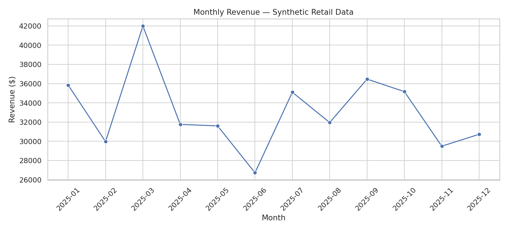
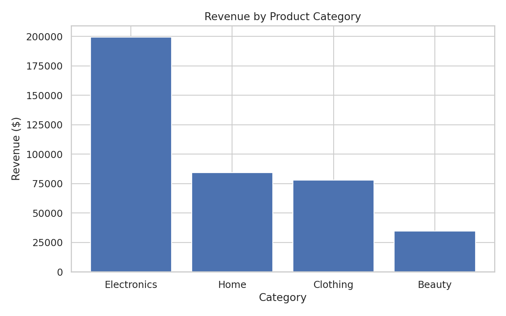
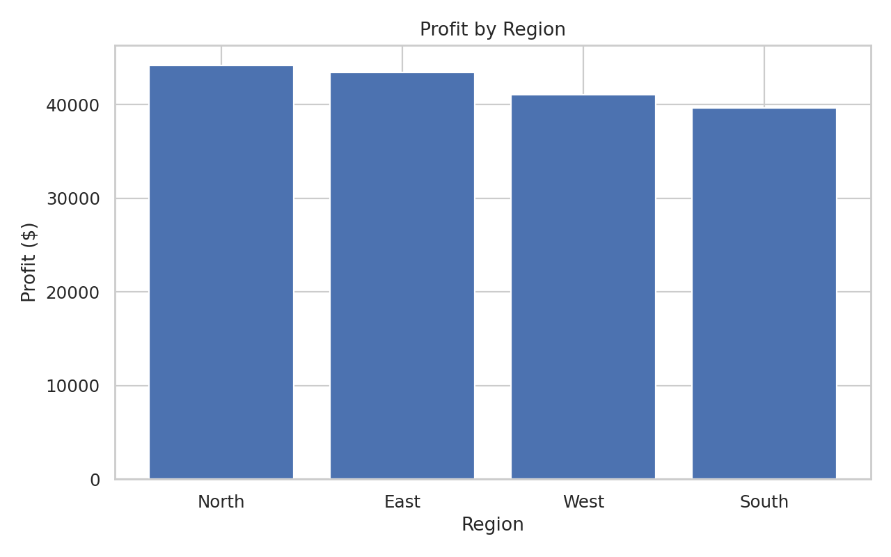

# Retail Sales & Customer Behavior Analysis

A reproducible **Python + SQL data analytics portfolio project** exploring synthetic retail transactions from 2025. Includes data validation, cleaning, exploratory analysis, customer segmentation, SQL business questions, and charts.

> **Data transparency:** All transactions are **synthetic**, generated with a fixed random seed. Findings are illustrative, not real company insights.

## Business questions
1. How do revenue and profit change by month?
2. Which product categories generate the most revenue?
3. Which regions generate the most profit?
4. Who are the highest-spending customers?
5. How do products compare on units sold and revenue?

## Repository structure
```text
retail-sales-analytics/
├── data/retail_sales.csv
├── scripts/generate_data.py
├── scripts/analyze.py
├── sql/business_questions.sql
├── notebooks/retail_sales_analysis.ipynb
├── outputs/ (charts, cleaned data, summaries, findings)
├── requirements.txt
├── LICENSE
└── README.md
```

## Quick start
```bash
python -m venv .venv
source .venv/bin/activate  # Windows: .venv\\Scripts\\activate
pip install -r requirements.txt
python scripts/generate_data.py
python scripts/analyze.py
jupyter notebook notebooks/retail_sales_analysis.ipynb
```

## KPIs and findings
See [outputs/findings.md](outputs/findings.md) for reproducible figures and caveats.





## SQL
Load `outputs/cleaned_sales.csv` into a SQLite table called `sales`, then run `sql/business_questions.sql`.

## Methods
- Validate missing values, uniqueness, positive quantities, nonnegative prices/costs, and discounts within 0–100%.
- Revenue = quantity × unit price × (1 − discount).
- Profit = revenue − (quantity × unit cost). This is **gross product profit**, excluding shipping, taxes, returns and overhead.
- Customer spend segments use illustrative thresholds: Low ≤ $200; Medium $200–$500; High > $500.

## Potential business recommendations
- Review the highest-revenue categories for merchandising opportunities, but assess margin and demand before investing.
- Investigate monthly peaks using external campaign or holiday information before attributing causes.
- Compare regional profit margins before deciding where to expand.
- Pilot retention campaigns for high-spend customers and measure incremental lift with an experiment.

## Limitations
This dataset is simulated, covers one year, has one line per order, and does not model returns, refunds, shipping, or customer acquisition costs. Segments are rule-based and not predictive. No causal claims should be drawn from these descriptive analyses.

## Suggested GitHub description
End-to-end retail sales analytics using Python, Pandas, SQL, and Seaborn: cleaning, EDA, customer segmentation, KPI reporting, and actionable insights on synthetic data.

## License
MIT — see [LICENSE](LICENSE).

## Run the full project, SQL, and validation

After installing dependencies, run these commands from the repository root:

```bash
python scripts/generate_data.py
python scripts/analyze.py
python scripts/run_sql.py
python tests/test_outputs.py
```

The SQL runner creates `outputs/retail_sales.sqlite` and five query-result CSV files. The validation script checks uniqueness, completeness, revenue/profit formulas, and reconciliation of monthly totals.

## Portfolio talking points

- **Problem framing:** Identify revenue drivers and compare regional profitability.
- **Data engineering:** Create repeatable input data and validate business rules before reporting.
- **Analytics:** Use Pandas and NumPy to compute financial metrics and customer segments.
- **SQL:** Query monthly performance, categories, customers, regions, and products.
- **Communication:** Explain limitations and translate descriptive results into testable recommendations.

### Optional Tableau extension

Connect Tableau Public to `outputs/cleaned_sales.csv` and build a dashboard with revenue, profit, orders, monthly trends, category mix, and region-level margins. A Tableau workbook is not included; Tableau is optional and does not replace the Python and SQL analyses.
